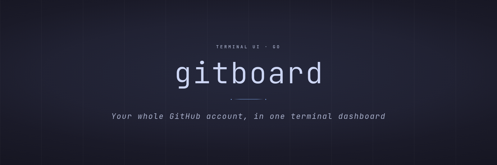
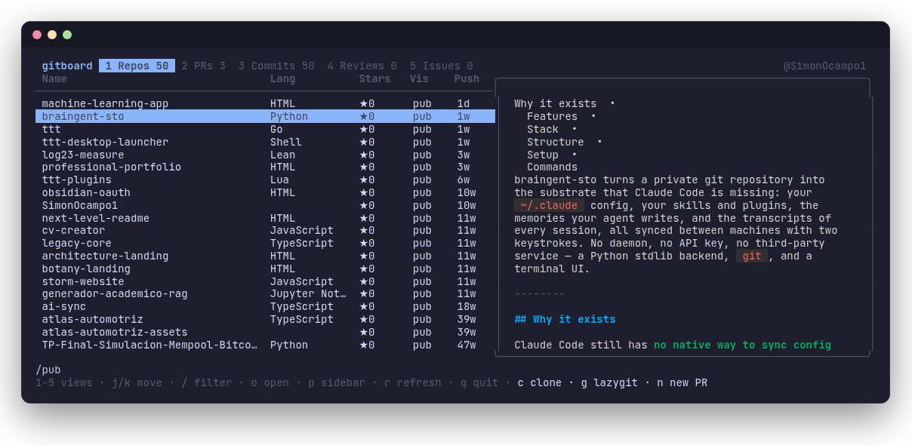

<p align="center">
  
</p>

<p align="center">
  
  
  
</p>

<p align="center">
  <a href="#features">Features</a> &nbsp;•&nbsp;
  <a href="#keys">Keys</a> &nbsp;•&nbsp;
  <a href="#stack">Stack</a> &nbsp;•&nbsp;
  <a href="#structure">Structure</a> &nbsp;•&nbsp;
  <a href="#install">Install</a>
</p>

gitboard shows your GitHub account in one terminal window: your repos, your open PRs, your latest commits, the reviews waiting on you and the issues assigned to you. I use `gh-dash` for PRs and `lazygit` for local work, but I kept opening the browser just to find a repo, check what I pushed yesterday or clone something. This is that missing screen.

<p align="center">
  
</p>

## Features

- Five views, switched with `Tab` or the arrows: Repos, PRs, Commits, Reviews and Issues. All five load in parallel when it starts. Internally every view becomes the same kind of row, which is why `/` filters and the sidebar behave the same in all of them.
- gitboard never asks you to log in. It borrows the session of the `gh` CLI through `go-gh`, so if `gh auth status` works, gitboard works.
- `c` clones the selected repo. The prompt starts at the last folder you cloned into, `Tab` completes paths the way your shell does, and `Ctrl+O` opens a small folder browser. If the target folder already exists, it stops and tells you instead of cloning on top of it.
- The sidebar shows a repo's README, a PR's description and checks, or a commit's full message and the files it touched. It fetches each one the first time you land on the row, renders it with Glamour and keeps it.
- Anything `gh` or `lazygit` already does well is handed to them. Diff, merge and approve call `gh`; `g` opens `lazygit` in your local clone and `n` runs `gh pr create` there.
- Commits come from GitHub's commit search, which only indexes each repo's default branch. A commit on a feature branch shows up after you merge it. Bot and sync commits are listed too, on purpose.

## Keys

| Where | Key | Action |
|---|---|---|
| Everywhere | `Tab` / `←` `→` (or `1`-`5`) | Switch view |
| | `j` `k` | Move |
| | `/` | Filter rows (`Enter` keeps it, `Esc` clears it) |
| | `f` | Show only the selected row's repo, in every view (`f` again clears it). From Repos it focuses the other views on that repo |
| | `s` | Group rows by repo, most active repo first, each group under its own title (not in Repos, where every row is a repo) |
| | `o` | Open in your default browser (`$BROWSER` if it exists) |
| | `p` | Toggle the sidebar (open by default from 120 columns) |
| | `Ctrl+D` `Ctrl+U` | Scroll the sidebar |
| | `r` | Reload the current view |
| | `?` | Show every key in the help line |
| | `q` | Quit |
| Repos | `c` | Clone |
| | `g` | `lazygit` in the local clone |
| | `n` | `gh pr create` in the local clone |
| PRs | `d` / `m` | Diff / merge |
| Commits | `y` | Copy the SHA (OSC 52) |
| Reviews | `d` / `a` | Diff / approve |
| Issues | `x` `x` | Close (press twice) |

## Stack

| Layer | Technology | Why |
|---|---|---|
| UI | Bubble Tea v2, Bubbles, Lip Gloss | The same stack as `gh-dash`. ANSI colors only, so the board takes your terminal's palette. |
| Markdown | Glamour | Renders READMEs and PR bodies in the sidebar. |
| GitHub | `go-gh` | Official client library of the `gh` CLI: its auth, GraphQL for repos, PRs and issues, REST for commit search. |
| Config | `yaml.v3` | One value: the last clone destination, in `~/.config/gitboard/config.yml`. |

## Structure

```
main.go                 checks the gh session, starts the program
internal/gh/            GitHub queries; one search string per view
internal/ui/
  app.go                the board: views, sidebar, filter, quick actions
  items.go              every view flattened into one row type
  views.go              columns, help line and loader of each view
  clone.go              clone prompt and folder picker
internal/paths/         ~ expansion, Tab completion, never-overwrite check
internal/config/        the remembered clone destination
CONTEXT.md              glossary: view, quick action, clone destination...
```

## Install

```bash
gh auth login                                  # once, if gh is not set up yet
go install github.com/SimonOcampo1/gitboard@latest
gitboard
```

You need Go 1.27+ and an authenticated `gh`. `g` needs `lazygit` on your `PATH`. `g` and `n` look for the clone at `<last clone destination>/<repo name>`; a repo cloned somewhere else is not found yet.
